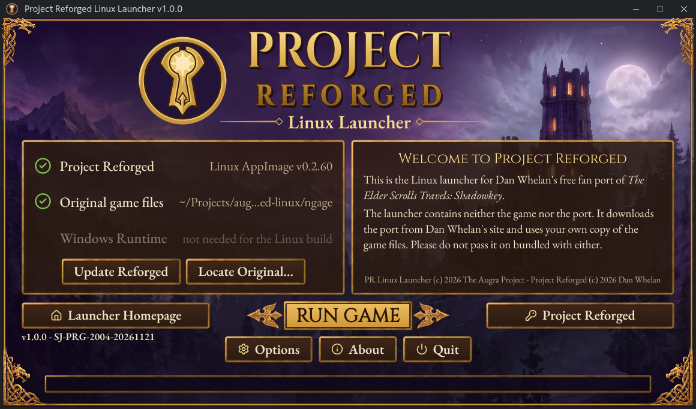
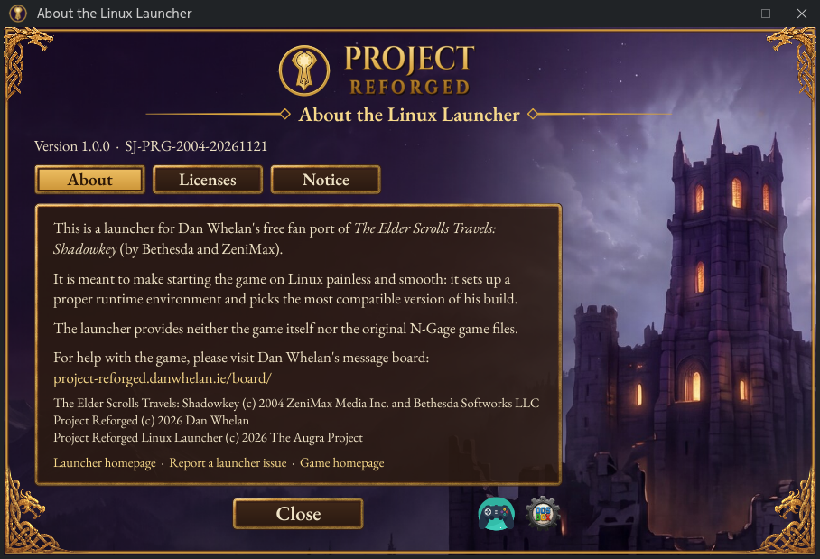

<!--
This file is part of the project-reforged-linux Project.
License: GPL-3.0-or-later. Contact: project-reforged-linux@trinity2k.net
Additional terms under GPLv3 section 7(b): see NOTICE.
-->

# Project Reforged Linux Launcher
## About the Launcher

Play *Project Reforged* on Linux with one click.

*Project Reforged* is Dan Whelan's free fan port of *The Elder Scrolls Travels:
Shadowkey*, the 2004 N-Gage role-playing game, rebuilt for the PC. You can find
it at [project-reforged.danwhelan.ie](https://project-reforged.danwhelan.ie).

This launcher gets it running on Linux without any fiddling. It downloads his
game straight from his site, keeps it up to date, and starts it with your own
copy of the original N-Gage game files. You don't have to install Wine, set up
a prefix or move files around by hand.

This Linux launcher is licensed under the GNU General Public License, version 3 or later, for the full license, [see below](#license).

<div align="center">


[](#license)


[](https://github.com/augra-project/project-reforged-linux-launcher/releases/latest)

[All releases](https://github.com/augra-project/project-reforged-linux-launcher/releases) |
[Report a problem](https://github.com/augra-project/project-reforged-linux-launcher/issues)
</div>

---
## Screenshots
### Main interface
<a href="docs/screenshots/launcher-linux-build.png"></a>&nbsp;
<a href="docs/screenshots/launcher-windows-build.png"></a>&nbsp;

### About dialog
<a href="docs/screenshots/about.png"></a>

## What it does

Dan publishes his game for Linux and for Windows. The launcher looks at your
system and picks the build that will run best on it: his native Linux build
where your system can run it, and his Windows build otherwise. The Windows
build runs through a Wine runtime that comes inside the launcher, so you don't
need Wine on your system at all. If you
would rather choose for yourself, Options lets you pick the build and the Wine
it runs with, including a Wine you already have installed.

On top of that it:

- checks his site for a newer build when it starts, and updates with one click
- finds your original game files in a zip file or a folder
- keeps your saved games in step between his Linux and Windows builds
- offers to add a menu entry and icon, so GNOME shows it properly in the dock
- writes a log you can attach when something goes wrong

## Getting started

1. Download the AppImage from the
   [releases page](https://github.com/augra-project/project-reforged-linux-launcher/releases/latest).
2. Make it executable, either in your file manager's properties or with
   `chmod +x project-reforged-linux-launcher-*.AppImage`.
3. Start it.

On the first start the launcher explains what it is going to do and asks a
couple of questions. After that you click **Locate Original...** and point it at
your N-Gage game files, either the zip file or the folder you unpacked it into.
Then **Update Reforged** fetches Dan's game, and **RUN GAME** starts it.

## What you need

- A 64-bit x86 Linux system with a desktop (X11 or Wayland).
- A graphics driver with Vulkan support. The game draws through Vulkan on
  Linux, and your distribution's standard Mesa or NVIDIA driver is usually
  all it takes.
- Your own copy of the original N-Gage game files of *The Elder Scrolls
  Travels: Shadowkey*. Neither this launcher nor Dan's game includes them.

## Your files

The launcher keeps everything in the usual places in your home folder, so you
can back it up or remove it without hunting:

- `~/.local/share/project-reforged-linux/`: Dan's game as the launcher installed
  it, and the Windows build's saves
- `~/.local/share/Shadowkey/`: Dan's Linux builds keep their settings and saves
  here, as they do without the launcher
- `~/.config/project-reforged-linux/`: the launcher's settings
- `~/.cache/project-reforged-linux/`: the downloaded builds
- `~/.local/state/project-reforged-linux/logs/`: the log files

To remove the launcher, first remove its menu entry in Options if you added one.
Then delete the AppImage and these folders. Your saves are in
`~/.local/share/Shadowkey/` for Dan's Linux builds and in
`~/.local/share/project-reforged-linux/prefix/drive_c/users/<your user name>/AppData/Roaming/Shadowkey/`
for his Windows build; copy them somewhere first if you want to keep them.

## What it connects to

The launcher talks to Dan's site, and only when it needs to: at every start it
asks whether a newer build of his game is out (you can turn that off in
Options), and it downloads his game from there when you install or update.

It can also ask GitHub whether a newer version of the launcher itself exists.
That check is off unless you switch it on. When it is on, GitHub sees your IP
address and the launcher's version at every start.

Nothing else is sent anywhere. There is no telemetry.

## Getting help

For questions about the game itself, please visit Dan Whelan's message board at
[project-reforged.danwhelan.ie/board](https://project-reforged.danwhelan.ie/board/).

If the launcher misbehaves, please
[open an issue here](https://github.com/augra-project/project-reforged-linux-launcher/issues)
and attach `launcher.log` from the log folder above. The log writes your home
folder as `~`, so your user name stays out of it. Please don't take launcher
problems to Dan's board: he didn't make this launcher and can't fix it.

## Building from source

You need Python 3.12 or newer.

```sh
git clone https://github.com/augra-project/project-reforged-linux-launcher.git
cd project-reforged-linux-launcher
python3 -m venv .venv
.venv/bin/pip install -e '.[dev]'
.venv/bin/python -m project_reforged_linux
```

`.venv/bin/pytest` runs the tests.

## License

*Copyright (c) 2026 The Augra Project*

Website: https://www.github.com/augra-project

The launcher is free software under the **GNU General Public License, version 3
or later** (see [LICENSE](LICENSE)). You may use it, share it, change it and build on it.
The components it ships with are listed with their licenses in
[THIRD_PARTY_LICENSES.txt](THIRD_PARTY_LICENSES.txt).

Additional terms, as section 7 of the GPLv3 permits (see [NOTICE](NOTICE)):

- Keep the attribution that names the Augra Project as the launcher's origin,
  together with its sister projects luducat and dosbox-automation and their
  links, in your README and wherever your application shows its credits or
  About page.
- Keep the notice about the original game files.
- A changed version must say that it is changed, and must not present itself
  as this launcher or as coming from the Augra Project. The names and logos of
  the launcher and of the Augra Project are not licensed with the code.

What this license does not cover:

- Project Reforged is Dan Whelan's work. The launcher downloads it from his
  site and does not include it. Only he can allow anyone to pass it on. The
  launcher's license does not extend to his game: the launcher starts it as a
  separate program, and nothing here gives anyone a claim to his source code.
- The original N-Gage game files belong to ZeniMax Media Inc. and/or Bethesda
  Softworks. Neither the launcher nor Dan's game includes them, and nothing
  here gives you a right to them.

Do not bundle the launcher with either of them. This license cannot stop it,
but such a package is against the wishes of the Augra Project, is not ours and
is not endorsed by us.

## Disclaimer
This launcher is an independent project. It is not made by or associated with
Dan Whelan's Project Reforged, Bethesda Softworks or ZeniMax Media.

The Augra Project publishes the launcher only as the AppImage and its source on
the GitHub releases page of this repository. Any other package of it comes from
someone else.

The Elder Scrolls, The Elder Scrolls Travels: Shadowkey, Bethesda and ZeniMax
are trademarks or registered trademarks of ZeniMax Media Inc.

---
Project Reforged Linux Launcher has been written with the help of tooled assistance,
but has been designed, reviewed and thoroughly tested and signed off by its
developer.
